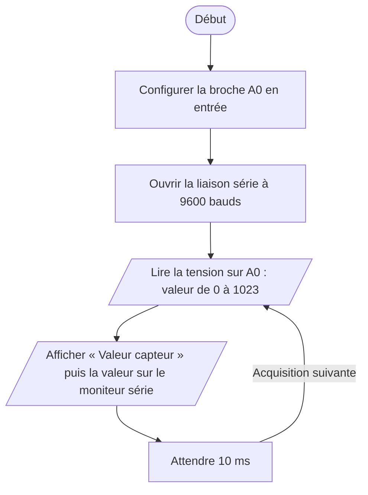

# IV.B — Test unitaire du capteur PPG WPSE340

**Emplacement dans le rapport :** Partie IV, module concerné, « 2. Protocole de test unitaire et critères de réussite ».

**Ce que représente l’algorigramme :** Programme de test `bpm_test.cpp` : lecture brute de la sortie du capteur et affichage sur le moniteur série, sans calcul de BPM.

**Légende proposée :** Algorigramme du test unitaire du capteur PPG : lecture analogique répétée et affichage série.

**Note :** Le programme ne s’arrête pas : la boucle est répétée tant que la carte est alimentée. Le doigt est posé par l’expérimentateur pendant l’exécution.
