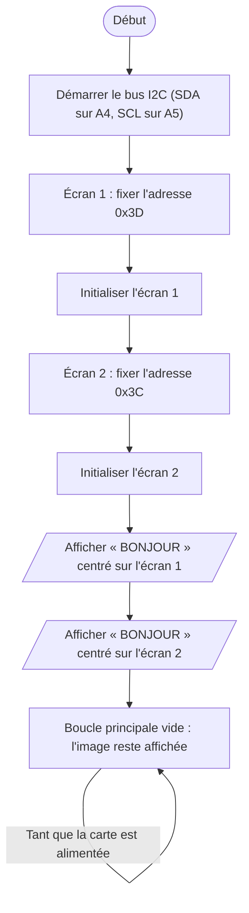

# IV.C — Test unitaire des deux écrans OLED

**Emplacement dans le rapport :** Partie IV, module concerné, « 2. Protocole de test unitaire et critères de réussite ».

**Ce que représente l’algorigramme :** Programme de test `Oled_test.cpp` : initialisation des deux écrans sur le même bus I²C et affichage du même texte.

**Légende proposée :** Algorigramme du test unitaire des deux écrans OLED : deux adresses sur un bus I²C commun.

**Note :** La bibliothèque U8g2 reçoit l’adresse décalée d’un bit vers la gauche ; ce détail n’est pas représenté.
