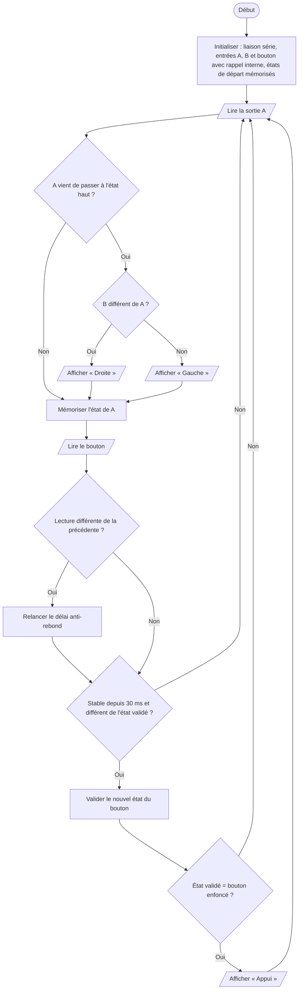

# IV.D — Test unitaire de l’encodeur et de son bouton

**Emplacement dans le rapport :** Partie IV, module concerné, « 2. Protocole de test unitaire et critères de réussite ».

**Ce que représente l’algorigramme :** Programme de test `encodeur_test.cpp` : détection du sens de rotation et de l’appui, avec affichage sur le moniteur série.

**Légende proposée :** Algorigramme du test unitaire de l’encodeur rotatif : sens de rotation et appui avec anti-rebond.

**Note :** Écart rapport/code : dans ce programme de test, A est sur D2, B sur D3 et le bouton sur D4. Dans le programme final, le bouton est sur D2, A sur D3 et B sur D4. De plus, ce test signale l’appui à l’enfoncement, alors que le programme final agit au relâchement.
