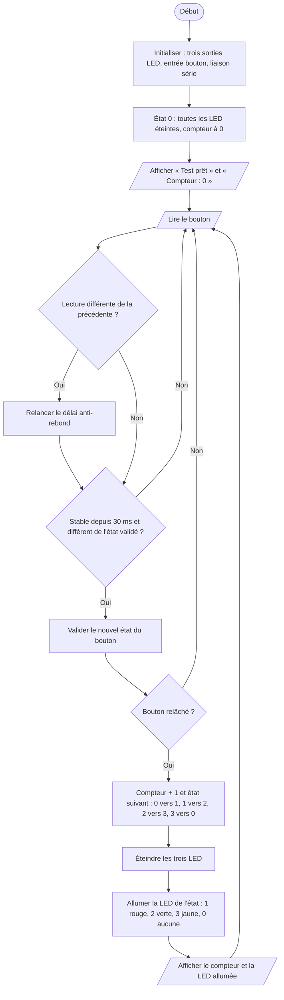

# IV.E — Test du bouton poussoir avec les LED

**Emplacement dans le rapport :** Partie IV, module concerné, « 2. Protocole de test unitaire et critères de réussite ».

**Ce que représente l’algorigramme :** Programme de test `btn_leds_test.cpp` : chaque appui validé fait avancer la séquence rouge, verte, jaune, toutes éteintes.

**Légende proposée :** Algorigramme du test du bouton poussoir et des trois LED : un changement d’état par appui, pris en compte au relâchement.

**Note :** Le bouton du test est câblé vers +5 V avec une résistance de rappel à la masse : l’état « relâché » correspond au niveau bas. Écart avec le montage final : dans ce test les LED rouge, verte et jaune sont sur D6, D5 et D4 et le bouton sur D2 ; dans le programme final elles sont sur D8, D7 et D6, et le bouton de retour sur D9 avec rappel interne.
