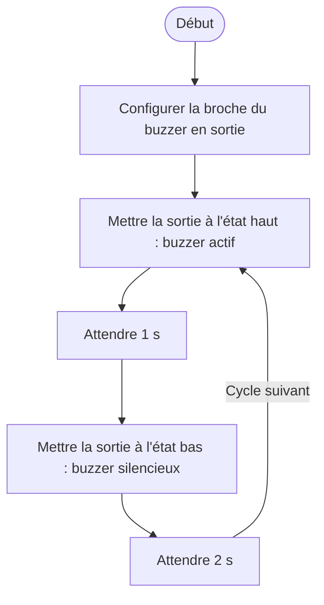

# IV.F — Test unitaire du buzzer

**Emplacement dans le rapport :** Partie IV, module concerné, « 2. Protocole de test unitaire et critères de réussite ».

**Ce que représente l’algorigramme :** Programme de test `buzzer_test.cpp` : commande tout ou rien du buzzer, une seconde de son puis deux secondes de silence.

**Légende proposée :** Algorigramme du test unitaire du buzzer : alternance d’une seconde de son et de deux secondes de silence.

**Note :** Écart rapport/code : ce test initial commande le buzzer en tout ou rien sur D8. Le programme final le pilote sur D5 avec trois tonalités (voir V.F). Un message de commit mentionne 2 s de son et 2 s de silence ; le code fait 1 s puis 2 s.
