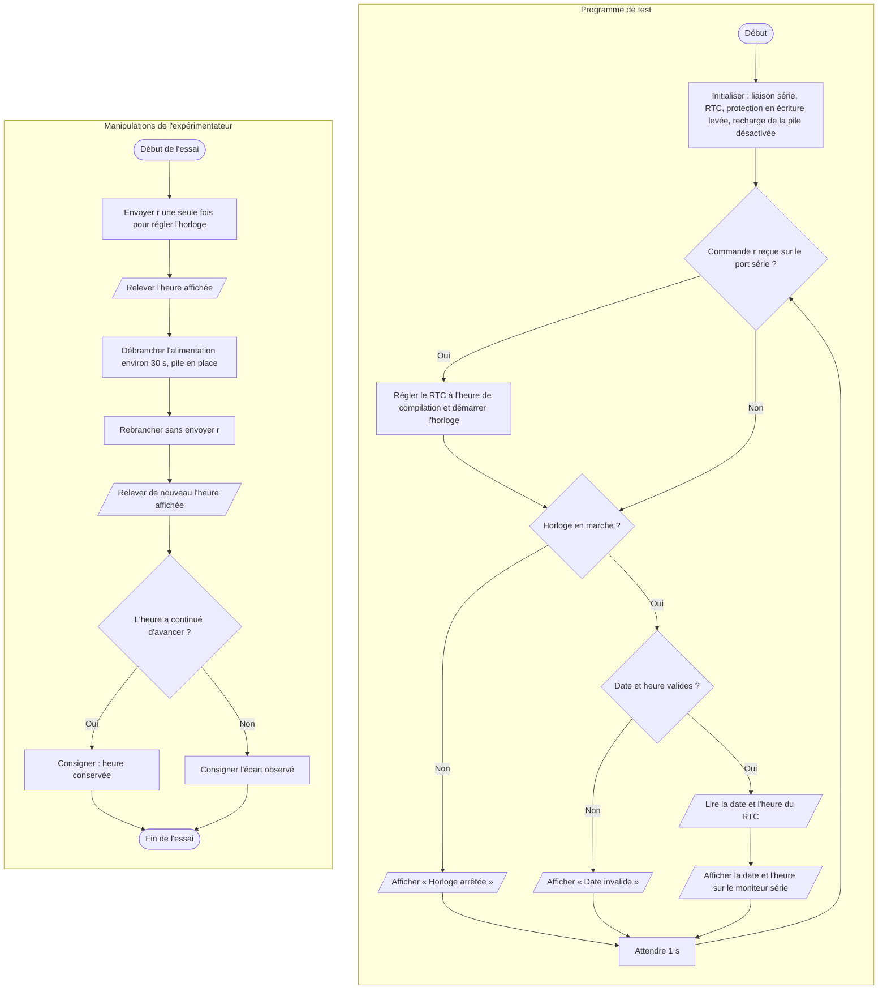

# IV.G — Test unitaire de l’horloge RTC DS1302

**Emplacement dans le rapport :** Partie IV, module concerné, « 2. Protocole de test unitaire et critères de réussite ».

**Ce que représente l’algorigramme :** Programme de test `rtc_test.cpp` et manipulations de l’expérimentateur pour vérifier que l’heure continue d’avancer pendant une coupure, pile en place.

**Légende proposée :** Algorigramme du test unitaire du RTC DS1302 : programme de lecture et manipulations de coupure d’alimentation.

**Note :** Écart rapport/code : le rapport indique que l’horloge est réglée à l’heure de compilation. Dans le programme de test, ce réglage n’a lieu que sur réception de la commande r, ce qui évite de réécrire l’heure après la coupure.
