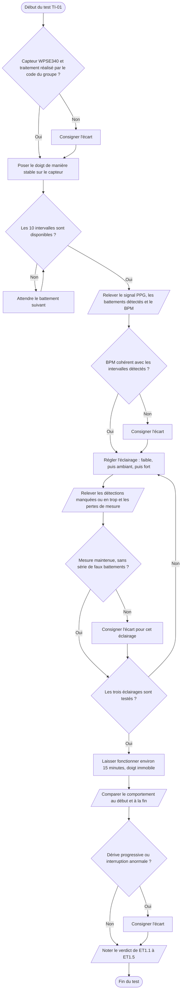

# VI.B — TI-01 : mesure de la fréquence cardiaque

**Emplacement dans le rapport :** Partie VI, test concerné, « 1. Protocole expérimental ».

**Ce que représente l’algorigramme :** Protocole expérimental prévu pour vérifier les exigences ET1.1 à ET1.5 sur le système complet.

**Légende proposée :** Algorigramme du protocole TI-01 : cohérence du BPM, robustesse à la luminosité et fonctionnement prolongé.

**Note :** Il s’agit du protocole prévu. Dans le rapport, les relevés sous trois éclairages et sur 15 minutes ne sont pas encore documentés.
