# VI.C — TI-02 : exactitude et conservation de l’heure

**Emplacement dans le rapport :** Partie VI, test concerné, « 1. Protocole expérimental ».

**Ce que représente l’algorigramme :** Protocole expérimental prévu pour vérifier ET2.1 à ET2.3 : écart initial, conservation après coupure et dérive sur environ 24 heures.

```mermaid
flowchart TD
    DEBUT(["Début du test TI-02"])
    REG["Régler l'heure du système une seule fois, à partir d'une référence affichant les secondes"]
    R0[/"Relever en même temps l'heure du système et l'heure de référence"/]
    C0["Calculer l'écart initial e0 = heure système moins heure de référence"]
    V0{"Valeur absolue de e0 inférieure ou égale à 30 s ?"}
    E0["Consigner l'écart sur ET2.2"]
    COUP["Débrancher l'alimentation environ 30 s, pile du RTC en place"]
    REDEM["Rebrancher sans régler l'heure"]
    V1{"L'heure a continué d'avancer ?"}
    E1["Consigner l'écart sur ET2.3"]
    ATT["Laisser fonctionner environ 24 h, correction de dérive active"]
    R1[/"Relever de nouveau les deux heures et noter la durée exacte"/]
    C1["Calculer e1, puis la dérive = e1 moins e0"]
    DUR{"Durée différente de 24 h ?"}
    NORM["Ramener la dérive à 24 h"]
    V2{"Valeur absolue de la dérive inférieure ou égale à 3 s par 24 h ?"}
    E2["Consigner l'écart sur ET2.1"]
    BILAN[/"Noter le verdict de ET2.1, ET2.2 et ET2.3"/]
    FIN(["Fin du test"])
    DEBUT --> REG --> R0 --> C0 --> V0
    V0 -->|"Oui"| COUP
    V0 -->|"Non"| E0 --> COUP
    COUP --> REDEM --> V1
    V1 -->|"Oui"| ATT
    V1 -->|"Non"| E1 --> ATT
    ATT --> R1 --> C1 --> DUR
    DUR -->|"Oui"| NORM --> V2
    DUR -->|"Non"| V2
    V2 -->|"Oui"| BILAN
    V2 -->|"Non"| E2 --> BILAN
    BILAN --> FIN
```

**Légende proposée :** Algorigramme du protocole TI-02 : écart initial, conservation de l’heure après coupure et dérive sur 24 heures.

**Note :** L’écart e0 mesure l’exactitude du réglage (ET2.2) ; la dérive e1 − e0 mesure l’évolution de cet écart dans le temps (ET2.1). Dans le rapport, seul le relevé initial est documenté (e0 = +1 s) ; le relevé à 24 h reste à faire.
