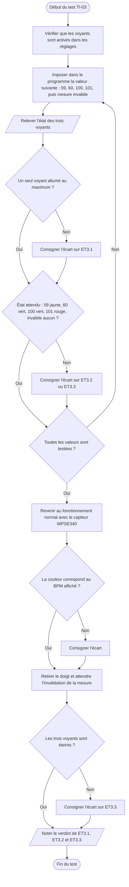

# VI.D — TI-03 : signalisation lumineuse

**Emplacement dans le rapport :** Partie VI, test concerné, « 1. Protocole expérimental ».

**Ce que représente l’algorigramme :** Protocole expérimental prévu pour vérifier ET3.1 à ET3.3 avec des BPM imposés aux limites des zones, puis avec le capteur réel.

**Légende proposée :** Algorigramme du protocole TI-03 : essais aux limites des zones, exclusivité des voyants et extinction sans mesure.

**Note :** Seuils de la version testée : jaune sous 60 BPM, vert de 60 à 100 BPM, rouge au-dessus de 100 BPM. Ils correspondent au code final. Une version antérieure du code et du rapport plaçait le seuil haut à 90 BPM : vérifier que cette valeur n’apparaît plus ailleurs dans le rapport.
