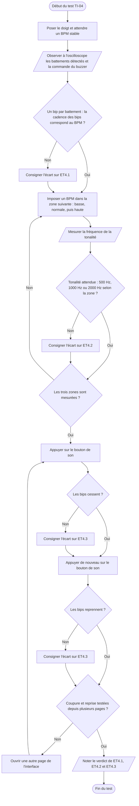

# VI.E — TI-04 : restitution sonore

**Emplacement dans le rapport :** Partie VI, test concerné, « 1. Protocole expérimental ».

**Ce que représente l’algorigramme :** Protocole expérimental prévu pour vérifier ET4.1 à ET4.3 : cadence des bips, tonalité selon la zone, coupure et reprise du son.

**Légende proposée :** Algorigramme du protocole TI-04 : cadence des bips, fréquence des trois tonalités, coupure et reprise du son.

**Note :** La cadence des bips (un par battement, donc liée au BPM) est distincte de la fréquence de la tonalité (500, 1000 ou 2000 Hz). Dans le rapport, seules la cadence et la tonalité de la zone normale (998 Hz mesurés) sont documentées ; le reste du protocole est à réaliser.
