# VI.F — TI-05 : affichage et zoom

**Emplacement dans le rapport :** Partie VI, test concerné, « 1. Protocole expérimental ».

**Ce que représente l’algorigramme :** Protocole expérimental prévu pour vérifier ET5.1 à ET5.4 : heure et BPM, tirets sans mesure, graphique gradué et échelle de temps réglable.

```mermaid
flowchart TD
    DEBUT(["Début du test TI-05"])
    DOIGT["Poser le doigt sur le capteur"]
    O1[/"Observer le second écran"/]
    V1{"Heure, date et BPM affichés ensemble ?"}
    E1["Consigner l'écart sur ET5.1"]
    RETIRE["Retirer le doigt"]
    V2{"Le BPM est remplacé par des tirets ?"}
    E2["Consigner l'écart sur ET5.1"]
    GRAPH["Reposer le doigt et ouvrir « Graphique » sur le premier écran"]
    V3{"Tracé continu du signal PPG ?"}
    E3["Consigner l'écart sur ET5.2"]
    V4{"Graduations présentes sur les deux axes ?"}
    E4["Consigner l'écart sur ET5.3"]
    TOURNE["Tourner l'encodeur d'un cran"]
    O2[/"Relever la largeur de fenêtre affichée"/]
    V5{"La fenêtre de temps a changé ?"}
    E5["Consigner l'écart sur ET5.4"]
    NIV{"Les niveaux de 1,1 s à 4,4 s sont parcourus ?"}
    BILAN[/"Noter le verdict de ET5.1 à ET5.4"/]
    FIN(["Fin du test"])
    DEBUT --> DOIGT --> O1 --> V1
    V1 -->|"Oui"| RETIRE
    V1 -->|"Non"| E1 --> RETIRE
    RETIRE --> V2
    V2 -->|"Oui"| GRAPH
    V2 -->|"Non"| E2 --> GRAPH
    GRAPH --> V3
    V3 -->|"Oui"| V4
    V3 -->|"Non"| E3 --> V4
    V4 -->|"Oui"| TOURNE
    V4 -->|"Non"| E4 --> TOURNE
    TOURNE --> O2 --> V5
    V5 -->|"Oui"| NIV
    V5 -->|"Non"| E5 --> NIV
    NIV -->|"Non"| TOURNE
    NIV -->|"Oui"| BILAN --> FIN
```

**Légende proposée :** Algorigramme du protocole TI-05 : affichage de l’heure et du BPM, tirets sans mesure, graduations et zoom temporel.

**Note :** En butée de zoom, un cran supplémentaire ne change pas la fenêtre : ce cas n’est pas un écart. La vérification de la base de temps avec un signal de période connue n’est pas prévue dans ce protocole.
