# VI.G — TI-06 : enregistrement et mémoire

**Emplacement dans le rapport :** Partie VI, test concerné, « 1. Protocole expérimental ».

**Ce que représente l’algorigramme :** Protocole expérimental prévu pour vérifier ET6.1 à ET6.5 : refus justifiés, enregistrement, consultation, conservation, effacement et langue.

```mermaid
flowchart TD
    DEBUT(["Début du test TI-06"])
    A1["Sans doigt, demander un enregistrement depuis le menu"]
    V1{"Refus avec le message « Pas de BPM » ?"}
    E1["Consigner l'écart"]
    A2["Poser le doigt et redemander aussitôt un enregistrement"]
    V2{"Refus avec « Mesure en cours » et le nombre de battements sur 10 ?"}
    E2["Consigner l'écart sur ET6.2"]
    A3["Attendre les 10 intervalles, puis enregistrer"]
    V3{"Message « Enregistré » avec le BPM, l'heure et la date ?"}
    E3["Consigner l'écart sur ET6.2 ou ET6.3"]
    A4["Ouvrir « Mes données »"]
    V4{"Mesure présente avec son BPM, sa date et son heure ?"}
    E4["Consigner l'écart sur ET6.3 ou ET6.4"]
    A5["Couper l'alimentation, redémarrer et rouvrir « Mes données »"]
    V5{"La mesure est conservée ?"}
    E5["Consigner l'écart sur ET6.1"]
    A6["Choisir « Effacer tout » et confirmer"]
    V6{"La liste est vide ?"}
    E6["Consigner l'écart sur ET6.4"]
    A7["Dans « Réglages », passer la langue en anglais, puis revenir en français"]
    V7{"Les textes suivent la langue choisie ?"}
    E7["Consigner l'écart sur ET6.5"]
    BILAN[/"Noter le verdict de ET6.1 à ET6.5"/]
    FIN(["Fin du test"])
    DEBUT --> A1 --> V1
    V1 -->|"Oui"| A2
    V1 -->|"Non"| E1 --> A2
    A2 --> V2
    V2 -->|"Oui"| A3
    V2 -->|"Non"| E2 --> A3
    A3 --> V3
    V3 -->|"Oui"| A4
    V3 -->|"Non"| E3 --> A4
    A4 --> V4
    V4 -->|"Oui"| A5
    V4 -->|"Non"| E4 --> A5
    A5 --> V5
    V5 -->|"Oui"| A6
    V5 -->|"Non"| E5 --> A6
    A6 --> V6
    V6 -->|"Oui"| A7
    V6 -->|"Non"| E6 --> A7
    A7 --> V7
    V7 -->|"Oui"| BILAN
    V7 -->|"Non"| E7 --> BILAN
    BILAN --> FIN
```

**Légende proposée :** Algorigramme du protocole TI-06 : refus d’enregistrement, enregistrement valide, consultation, conservation, effacement et langue.

**Note :** Le refus avant dix intervalles est bien présent dans le code. L’enregistrement se déclenche depuis l’entrée « Enregistrer » du menu, validée par le bouton de l’encodeur, et non par un bouton poussoir dédié. Dans le rapport, la conservation après coupure et l’effacement ne sont pas encore documentés.
