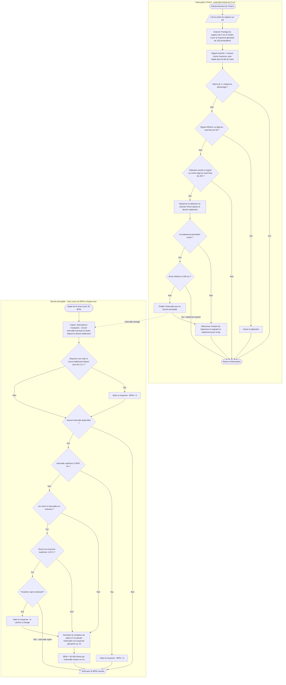

# V.B — Acquisition et traitement du signal PPG

**Emplacement dans le rapport :** Partie V, au début de la partie concernée, avant l’explication du fonctionnement.

**Ce que représente l’algorigramme :** Module `bpm` du programme final : détection des battements dans l’interruption du Timer1, puis calcul du BPM dans la boucle principale.

**Légende proposée :** Algorigramme de l’acquisition et du traitement du signal PPG : détection dans l’interruption, calcul du BPM dans la boucle principale.

**Note :** Les deux traitements ne s’enchaînent pas : l’interruption s’exécute toutes les 5 ms, la mise à jour du BPM à chaque tour de boucle ; la flèche en pointillés indique seulement la donnée partagée. Le BPM est obtenu à partir de la moyenne des intervalles, convertie en BPM, et non d’une moyenne de valeurs de BPM. Un BPM égal à 0 signifie « pas de mesure ».
