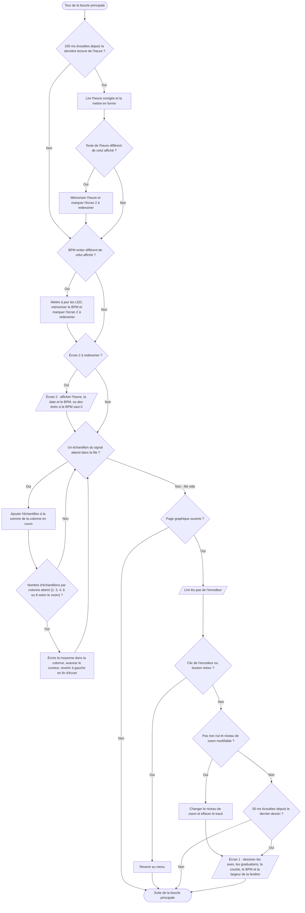

# V.C — Affichage du BPM et du graphique

**Emplacement dans le rapport :** Partie V, au début de la partie concernée, avant l’explication du fonctionnement.

**Ce que représente l’algorigramme :** Partie de la boucle principale et du module `gui` qui met à jour le second écran, alimente le tracé en permanence et dessine le graphique lorsque sa page est ouverte.

**Légende proposée :** Algorigramme de l’affichage : mise à jour du second écran, alimentation continue du tracé et dessin du graphique.

**Note :** Le tracé est alimenté à chaque tour, que la page graphique soit ouverte ou non ; il n’est dessiné que si elle est ouverte. Les cinq niveaux de zoom correspondent à des fenêtres d’environ 1,1 s à 4,4 s.
