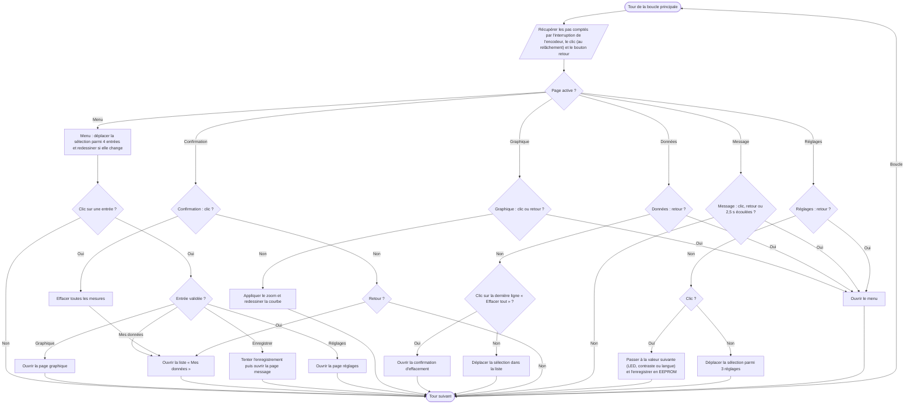

# V.D — Menu et navigation par encodeur

**Emplacement dans le rapport :** Partie V, au début de la partie concernée, avant l’explication du fonctionnement.

**Ce que représente l’algorigramme :** Machine à états des pages dans `main.cpp` : effet d’une rotation, d’un clic de l’encodeur et du bouton retour selon la page active.

**Légende proposée :** Algorigramme de la navigation : actions de l’encodeur et du bouton retour selon la page affichée.

**Note :** Le programme final comporte six pages : menu, graphique, données, confirmation d’effacement, message et réglages. La page réglages et le choix de la langue existent dans le code. Sur la page menu, le bouton retour n’a aucun effet.
