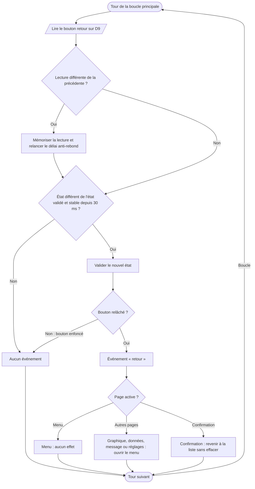

# V.E — Gestion du bouton retour

**Emplacement dans le rapport :** Partie V, au début de la partie concernée, avant l’explication du fonctionnement.

**Ce que représente l’algorigramme :** Lecture du bouton retour dans le module `peripheriques` (anti-rebond de 30 ms, événement au relâchement) et action selon la page active.

**Légende proposée :** Algorigramme de la gestion du bouton retour : anti-rebond, déclenchement au relâchement et action selon la page.

**Note :** Le bouton est lu à chaque tour de boucle pour que l’anti-rebond suive son état. L’événement est produit une seule fois, au relâchement. Le code attend un bouton entre D9 et la masse, avec la résistance de rappel interne.
