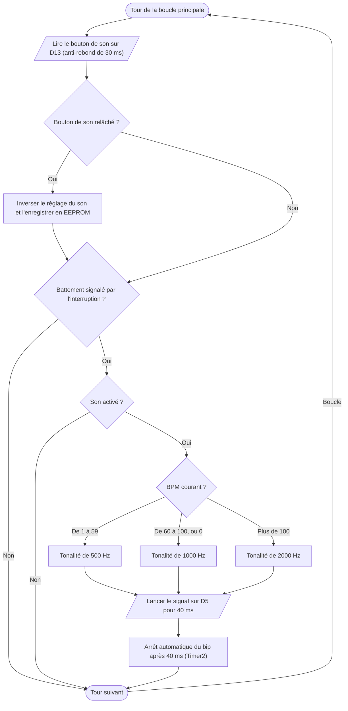

# V.F — Commande du buzzer

**Emplacement dans le rapport :** Partie V, au début de la partie concernée, avant l’explication du fonctionnement.

**Ce que représente l’algorigramme :** Module `peripheriques` du programme final : bouton de son, choix de la tonalité selon le BPM et bip de 40 ms à chaque battement.

**Légende proposée :** Algorigramme de la commande du buzzer : un bip de 40 ms par battement, trois tonalités, coupure par bouton.

**Note :** Les trois tonalités et la coupure du son sont présentes dans le code final. La temporisation du bip n’est pas gérée par la boucle : la fonction tone() arrête le signal seule. Un BPM de 0 (moyenne pas encore disponible) donne la tonalité de 1000 Hz. Le test unitaire IV.F, plus ancien, commandait le buzzer en tout ou rien.
