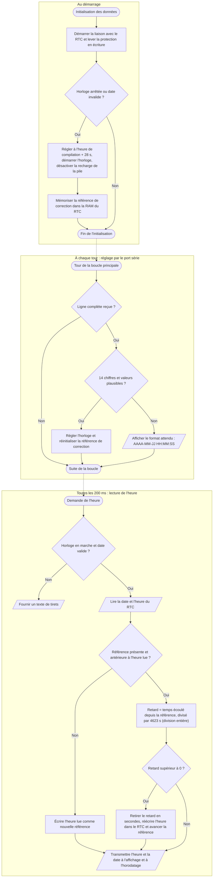

# V.G — Gestion de l’horloge RTC

**Emplacement dans le rapport :** Partie V, au début de la partie concernée, avant l’explication du fonctionnement.

**Ce que représente l’algorigramme :** Module `donnees` du programme final : initialisation du RTC au démarrage, réglage par le port série, lecture périodique avec correction de la dérive.

**Légende proposée :** Algorigramme de la gestion du RTC : initialisation, réglage par le port série et lecture avec correction de la dérive.

**Note :** La valeur de 4623 s vient de la dérive mesurée (+17 s en 21 h 50). La lecture corrigée sert aussi à horodater les enregistrements. Les flèches entre sous-graphes indiquent l’ordre général, pas un enchaînement à chaque appel.
