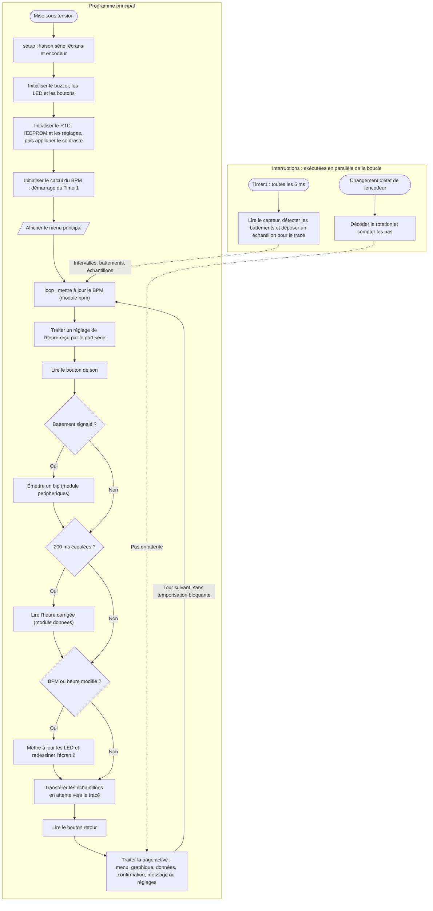

# V.H — Programme principal et gestion temporelle

**Emplacement dans le rapport :** Partie V, au début de la partie concernée, avant l’explication du fonctionnement.

**Ce que représente l’algorigramme :** Fonctions setup() et loop() de `main.cpp`, avec les appels aux modules, et rôle des deux interruptions.

**Légende proposée :** Algorigramme du programme principal : initialisation, boucle non bloquante et interruptions.

**Note :** La boucle n’utilise aucune temporisation bloquante : les périodes (200 ms pour l’heure, 50 ms pour le graphique) sont obtenues par comparaison avec millis(). Les flèches en pointillés représentent les données partagées avec les interruptions.
